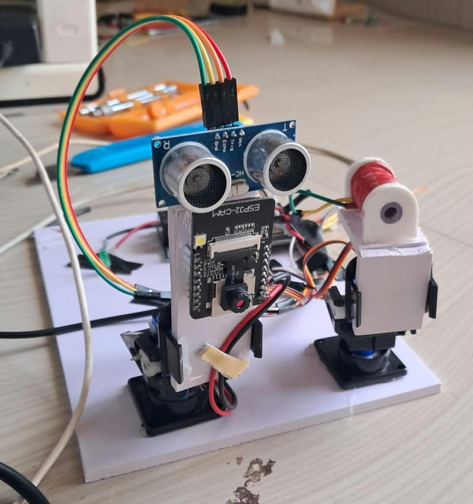
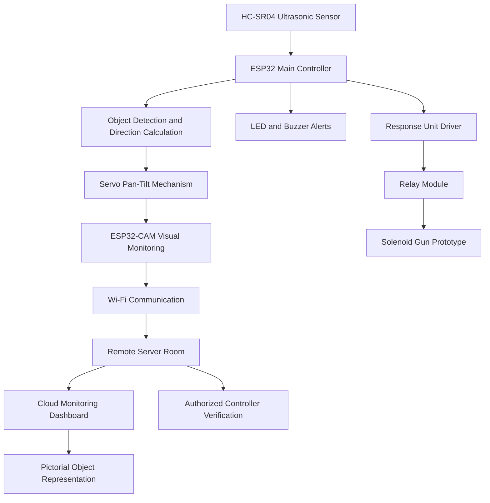
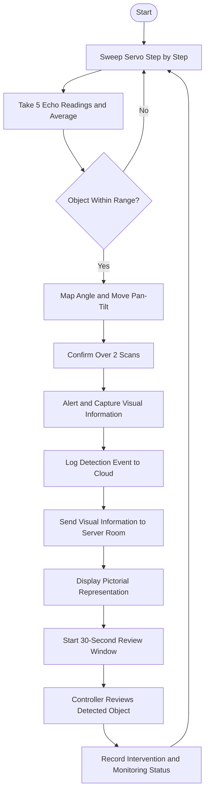

# 📡 AI-Enabled IoT Autonomous Radar Surveillance and Target Tracking System with Cloud Monitoring

  

  <b>Autonomous Perimeter Surveillance | Object Detection | Directional Tracking | Cloud Monitoring</b>

  
  
  
  

---

## 📌 1. Project Overview

The AI-Enabled IoT Autonomous Radar Surveillance and Target Tracking System is an embedded surveillance prototype designed for monitoring border boundaries, restricted zones and sensitive areas where continuous human monitoring may be difficult.

The system uses an HC-SR04 ultrasonic sensor to continuously scan the surrounding area, detect objects and measure their approximate distance and direction. Servo motors automatically orient the pan-tilt camera mechanism toward the detected object.

The ESP32-CAM captures visual information and transmits it through Wi-Fi to a remote server-room monitoring interface. The detected-object information is displayed through a pictorial representation on the cloud monitoring dashboard, allowing an authorized controller to review the detected event.

### ⏱️ 30-Second Human Intervention Concept

The proposed system incorporates a 30-second countdown after object detection. During this period, the authorized controller in the server room reviews the visual information and can intervene if the detected object is identified as harmless or authorized.

The original project concept includes an automatic response following timeout if no intervention occurs. The prototype includes a relay-controlled solenoid-based response subsystem. Public documentation describes this subsystem at a high level, with potentially harmful actuation kept independently inhibited.

The project integrates Embedded Systems, IoT, ultrasonic sensing, servo-based tracking, camera monitoring and remote surveillance.

---

## 🎯 2. Project Objectives

- Develop an ultrasonic-based object detection mechanism.
- Measure object distance and determine approximate direction.
- Implement automatic directional scanning using servo motors.
- Orient the camera toward the detected object.
- Integrate ESP32-CAM for visual monitoring.
- Generate alerts using LED and buzzer.
- Transmit detected-object information to a cloud monitoring interface.
- Provide a 30-second supervised review window.
- Integrate embedded hardware and IoT communication.

---

## 🏗️ 3. System Block Diagram

---

## ⚙️ 4. Software Algorithm / Workflow

The following workflow follows the seven stages of the software algorithm presented in the Phase II project review.

### Accuracy Techniques

- Median / average of multiple ultrasonic echo readings.
- Five echo readings averaged at each scanning angle.
- Temperature-compensated speed-of-sound calculation.
- Calibrated angle-to-servo mapping.
- Consecutive-scan confirmation to reduce false alerts.
- Servo settling delay for improved positioning.

---

## ☁️ 5. IoT and Cloud Monitoring

The project incorporates Wi-Fi-based communication to transfer detected-object information to a remote server-room monitoring interface.

### Cloud Monitoring Features

- Receives detected-object information.
- Displays detected-object information through pictorial representation.
- Supports remote visual monitoring.
- Transfers detection events to the server room.
- Provides information for authorized controller verification.
- Incorporates a 30-second monitoring countdown.
- Supports recording of monitoring and intervention events.

### Cloud Monitoring Workflow

1. An object is detected by the ultrasonic sensor.
2. The camera is oriented toward the detected direction.
3. ESP32-CAM captures visual information.
4. Information is transmitted through Wi-Fi.
5. The server-room dashboard displays the detected event.
6. The authorized controller reviews the visual information.
7. The 30-second supervised review period is recorded.

---

## ⏱️ 6. Time-Based Human Intervention

The prototype incorporates a 30-second review window after object detection.

During this period:

- The server-room controller receives the visual information.
- The detected object can be reviewed remotely.
- The controller can intervene when an object is identified as harmless or authorized.
- Intervention and timeout events can be recorded.

The original concept includes an automatic response after an unanswered timeout. For safe public demonstration and deployment, the response interface should remain independently inhibited unless a qualified human operator explicitly authorizes a safe test action.

---

## 🔧 7. Hardware Components

| Component | Purpose |
|---|---|
| ESP32 DevKit V1 | Main controller |
| HC-SR04 Ultrasonic Sensor | Object detection and distance measurement |
| ESP32-CAM | Visual monitoring |
| SG90 Servo Motors (2) | Pan and tilt camera positioning |
| Relay Module | Isolated response interface |
| Solenoid Actuator | Prototype response subsystem |
| LED | Visual indication |
| Buzzer | Audible alert |
| FTDI232 | ESP32-CAM programming |
| Breadboard | Circuit prototyping |
| Jumper Wires | Hardware connections |
| 5V Power Supply | Power management |

---

## 🔌 8. Circuit / Hardware Design

### ESP32 Pin Configuration

| Module | ESP32 Connection | Supply |
|---|---|---|
| HC-SR04 TRIG | GPIO 5 | 5V |
| HC-SR04 ECHO | GPIO 18 (via voltage divider) | 5V |
| Pan Servo | GPIO 13 | 5V |
| Tilt Servo | GPIO 12 | 5V |
| LED | GPIO 2 | 3.3V logic |
| Buzzer | GPIO 4 | 3.3V logic |
| Response Unit Driver | GPIO 14 (via transistor) | 5V |
| ESP32-CAM | Separate Wi-Fi link; programmed through FTDI232 | 5V |

### Hardware Design Notes

- Common ground for all modules.
- Servos powered through a separate 5V rail.
- Ultrasonic ECHO signal level-shifted to 3.3V.
- Response interface electrically isolated through a driver stage.
- Verify all pin numbers and supply values against the final wired prototype.

---

## 💻 9. Software and Technologies

- Arduino IDE 2.3.10
- Embedded C/C++
- ESP32 Programming
- Wi-Fi Communication
- IoT and Cloud Monitoring
- Hardware Interfacing
- Sensor Integration
- Servo Motor Control

---

## ✨ 10. Key Features

- **Autonomous Scanning:** Continuous area scanning using ultrasonic sensing.
- **Object Detection:** Distance measurement using HC-SR04.
- **Directional Tracking:** Servo-controlled camera positioning.
- **Visual Monitoring:** ESP32-CAM integration.
- **Alert System:** LED and buzzer indication.
- **Cloud Monitoring:** Pictorial representation of detected objects.
- **Remote Verification:** Server-room visual monitoring.
- **Timed Monitoring:** 30-second supervised review window.
- **Response Subsystem:** Relay-controlled solenoid-based prototype interface.

---

## 📊 11. Results and Analysis

### Phase I vs Phase II Improvements

| Parameter | Phase I | Phase II |
|---|---:|---:|
| Range Error | 3.5 cm | 1 cm |
| Servo Angle Error | 8° | 2° |
| Alert Delay | 1.2 seconds | 0.4 seconds |

*Values reported in the Phase II presentation; validate against original test measurements.*

### Implementation Progress

**Hardware Work Completed**

- Prototype assembled and wired.
- Pan-tilt camera mount fitted.
- Modules powered and tested.
- Final calibration completed.

**Software Work Completed**

- Scanning, detection and tracking logic coded.
- Filtering and angle calibration added.
- ESP32-CAM streaming and alerts integrated.
- IoT/cloud data link established.

---

## 🚀 12. Future Scope

- AI-based object recognition and classification.
- Advanced cloud monitoring dashboard.
- Remote notifications.
- Improved object tracking.
- Larger-area surveillance coverage.
- Improved prototype optimization.
- Enhanced monitoring and event management.

---

## 👨‍💻 13. Project Team

| Team Member | USN |
|---|---|
| Deepa Paris Naganur | 2BA23EC035 |
| Kartik Veeranagoudar | 2BA23EC044 |
| Suhana Nadaf | 2BA23EC112 |
| Vikas V Menasagi | 2BA23EC121 |

**Project Guide:** Dr. Vijayalakshmi S. Jigajinni  
Associate Professor

**Department:** Electronics and Communication Engineering

**Institution:** Basaveshwar Engineering College, Bagalkot

---

  <b>Developed as an Engineering Major Project</b>
   
  ❤️ Embedded Systems | IoT | Digital Electronics | Automation

